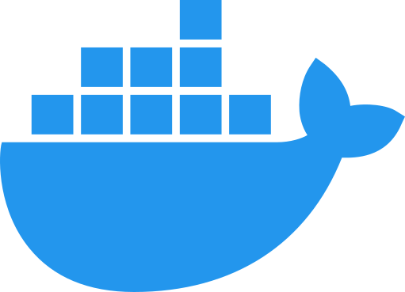

<p align="center">
  
</p>

<h1 align="center">aac-docker-proxy</h1>

<p align="center">A security-enhanced, access-filtered proxy for the Docker socket API.</p>

<p align="center">
  <a href="https://github.com/Tecnativa/docker-socket-proxy"></a>
  <a href="https://github.com/Tecnativa/docker-socket-proxy/pkgs/container/docker-socket-proxy"></a>
  <a href="https://github.com/Tecnativa/docker-socket-proxy/blob/master/LICENSE"></a>
</p>

## About

`aac-docker-proxy` deploys [Tecnativa's docker-socket-proxy](https://github.com/Tecnativa/docker-socket-proxy)
as an App-as-Code service. The proxy mounts the host Docker socket once and exposes the
Docker Engine API over plain HTTP on port `2375`. Environment variables decide which API
sections are reachable; every other request is answered with `HTTP 403 Forbidden`.

Services that only need to read container state or react to events can use the proxy
instead of receiving full access to `/var/run/docker.sock`.

### Key features

- Allow-list access to Docker API sections via environment variables
- Read-only mode by default (`POST` is the switch for write operations)
- Built on the official Alpine-based HAProxy image
- Configurable socket location (`SOCKET_PATH`) for non-standard Docker hosts

## Upstream

- Project: <https://github.com/Tecnativa/docker-socket-proxy>
- Container image: `ghcr.io/tecnativa/docker-socket-proxy:v0.5.0` (also on Docker Hub as `tecnativa/docker-socket-proxy`)
- Documentation: see the upstream README for the full list of API sections and supported API versions

## Quick start (Docker Compose)

This repository has no secrets, so no `.env` file is required.

```yaml
services:
  docker-proxy:
    image: ghcr.io/tecnativa/docker-socket-proxy:v0.5.0
    restart: always
    ports:
      - "127.0.0.1:2375:2375"
    volumes:
      - /var/run/docker.sock:/var/run/docker.sock
    environment:
      CONTAINERS: "1"
      POST: "1"
      SERVICES: "1"
      TASKS: "1"
```

```bash
docker compose up -d
```

With the loopback binding above, point a local client at the proxy with
`DOCKER_HOST=tcp://localhost:2375`.

> **Security:** the proxy speaks unauthenticated plain HTTP. Do not expose port `2375`
> to untrusted networks. Bind it to a private interface or to a Docker network that only
> contains the proxy and the services that need it.

## Configuration

### Environment variables

Values are set in `service.yml`. Access toggles accept `1` (grant) or `0` (revoke).

| Variable | Value in this service | Description |
|----------|-----------------------|-------------|
| `CONTAINERS` | `1` | Container API section (`/containers/*`). Revoked by default upstream. |
| `POST` | `1` | Allow non-GET/HEAD requests. When `0`, the proxy is read-only. |
| `SERVICES` | `1` | Swarm services API section. |
| `TASKS` | `1` | Swarm tasks API section. |
| `TZ` | `Europe/Berlin` | Timezone variable carried in the service definition. Not documented by upstream. |
| `PUID` | `1000` | User ID variable carried in the service definition. Not documented by upstream. |
| `PGID` | `1000` | Group ID variable carried in the service definition. Not documented by upstream. |

Other upstream toggles (for example `AUTH`, `SECRETS`, `IMAGES`, `NETWORKS`, `SYSTEM`,
`EXEC`) are not set by this service and keep their upstream defaults. `SOCKET_PATH` can
be set if the host socket is not at `/var/run/docker.sock`.

### Ports

| Container port | Protocol | Purpose |
|----------------|----------|---------|
| `2375` | TCP | Docker API proxy (plain HTTP) |

### Volumes

| Host path | Container path | Purpose |
|-----------|----------------|---------|
| `/var/run/docker.sock` | `/var/run/docker.sock` | Docker Engine socket (read by the proxy, filtered on the way out) |

## Deploy with App-as-Code

The deployment definition lives in `service.yml`. The App-as-Code template engine renders
the Docker Compose manifest from it. Changes are made in `service.yml`, not in the rendered
output. Releases are published under <https://github.com/app-as-code/aac-docker-proxy>.

## Credits and license

- The proxy software is developed by Tecnativa and licensed under the Apache License 2.0
  (see the upstream repository).
- The icon is taken from the [homarr-labs/dashboard-icons](https://github.com/homarr-labs/dashboard-icons)
  collection. Source and notes are in [`assets/ICON_SOURCE.md`](assets/ICON_SOURCE.md).
- This repository contains only the deployment definition for the service and is not a
  fork of the upstream project.
